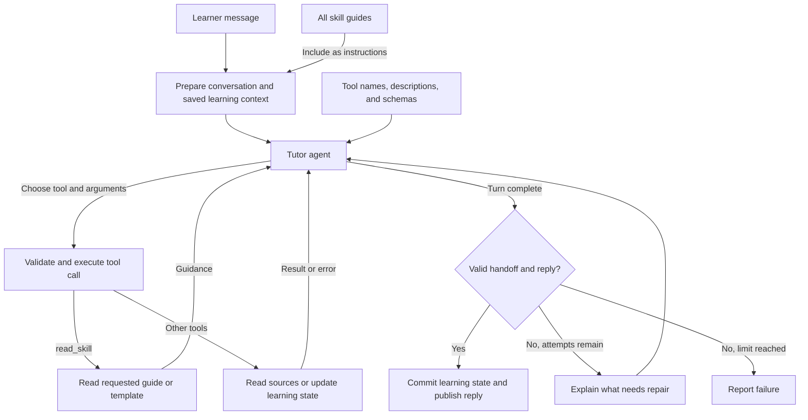

	

<h1 align="center">EdU, Tutor Agent Harness</h1>

Alpha Release, M-Series Macs Only

## Why?

Do you **really understand** what your prof is trying to say? Bloated and outdated slides makes it hard for you to tell what needs to be understood.

We resort to tools like ChatGPT, Gemini, and Claude to try to help us clarify and evaluate our understanding. However, 
- Verbose responses drains you.
- Your understanding is not validated as you progress.
- Explanations misalign with what needs to be understood.
- No understanding of your progress and past mistakes.
- Shallow evaluation, gives you a false sense of confidence in understanding.

**EdU guides your understanding.**

## EdU's Principles

The agent is designed from 3 principles:
- **Use what exists, don't make shit up.** Prioritises walkthroughs, checks and questions based on what you give. Else, find it online.
- **Deliberation guides understanding** Don't assume correctness. Ask clarification, give edge cases, ask for validation.
- **Don't overwhelm** Chunk part by part, not all at once.

## Features

### The Scratchpad
The scratchpad is where the Tutor documents your understanding. 

3 Types,
- **Topic**, Course content walkthrough guides.
- **Test**, Like a typical test.
- **Generic**, Anything else.

### Topic Walkthrough
Attach your course slides, tutorials, past year papers and walk through. 

It goes:
1. Create topic, `/new-topic <topic>`
2. Proposes plan, you accept or amend
3. Explain part by part. After each part, asks for a check

When you make a mistake, it gets documented.

### Tests
`@Tag` the topic / ask it what you want to be tested on. Based on your past mistakes, sources questions from online or based on your attached resources that evaluates those mistakes.

It goes:
1. Create test, `/new-test <topic>`
3. Ask question by question.

### Tutor Agent Runners
Use your existing AI subscription (Use whats provided by your school of course!), **EdU is only a Harness**.

Supports
- Codex
- Claude Code
- Antigravity

## Architecture

EdU combines a tutor agent, persistent scratchpads, and a private handoff between turns. Skills guide how the tutor teaches. Tools let it read sources and record learning evidence.

### Orchestration

EdU runs the selected provider in a bounded retry loop, validates its output, and requests repairs when needed. At the start of each turn, EdU includes all skill guides in the tutor's instructions alongside the conversation and saved learning context. The tutor follows the management skill matching the request and scratchpad type, plus the shared feedback, understanding, and writing guidance. It can call `read_skill` to retrieve a guide or scratchpad template.

EdU also supplies tool names, descriptions, and input schemas. The tutor chooses a tool and its arguments based on the task and skill guidance. EdU validates and executes the call, then returns its result or error so the tutor can continue or repair the call.

- Codex calls dynamic tools.
- Claude Code and Antigravity call the same tools through a local MCP server.

Before finishing, the tutor calls `save_learning_state` with its private handoff and next action. EdU publishes only after validating the saved handoff and reply. Failed validation returns repair instructions to the tutor, with up to three provider runs per turn.

### Tools

All providers use the same tutoring tools. Scratchpad tools are grouped by type:

| Tool | Purpose |
| --- | --- |
| `read_material` | Read attached source pages, including PDF visuals on supported providers. |
| `read_scratchpad` | Read a scratchpad's content, type, and recorded learning state. |
| `read_skill` | Read a tutoring guide or scratchpad template. |
| `topic_*` | Plan walkthroughs, edit explanations, record checks and answers, and track progress and mistakes. |
| `test_*` | Establish taught scope, add questions, record answers, and review mistakes. |
| `generic_*` | Maintain free-form notes and references. |
| `save_learning_state` | Save the private handoff, next action, and pending question for the next turn. |

### Skills

Bundled Markdown guides define the tutor's teaching behavior:

| Skill | Responsibility |
| --- | --- |
| Manage topic | Propose a plan, teach one section at a time, check understanding, and maintain the walkthrough. |
| Manage test | Select verified practice questions within taught scope, balance coverage, and ask one question at a time. |
| Manage generic | Maintain a free-form scratchpad for work outside walkthroughs and tests. |
| Feedback and deliberate | Assess the learner's reasoning, probe gaps, and record confirmed mistakes. |
| What is understanding | Judge demonstrated understanding against learning objectives, including the reasoning behind an answer. |
| Writing style | Explain concepts directly, with worked examples and visuals where useful. |
| Unslop | Remove filler and vague language, and keep scratchpad names specific. |
