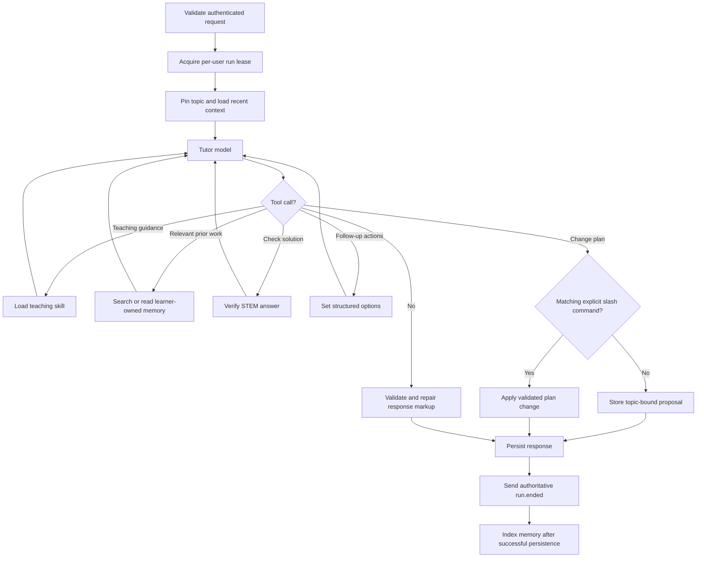

# Tutor execution

The Tutor chooses tools directly through the OpenAI SDK, using OpenRouter.
There is no preliminary intent-classification call or separate answer/practice
routing pipeline. Simple explanations can complete in one model call.

The loop permits at most eight model turns, one tool per turn, with a
120-second run deadline. Zod validates tool arguments. Repository ownership
checks and plan authorization are enforced outside the model. Natural-language
plan changes require acceptance of a stored proposal. With an active topic,
starting a different subject requires `/new`. `/update` authorizes focus
updates; `/ans`, `/new-qns`, and `/topic` express teaching intent.

Cancellation retains the lease until execution settles. A plan change that
has already committed remains completed. Failed response persistence produces
a failed terminal event. Streaming text is provisional; `run.ended` replaces
it with authoritative parts. LaTeX and Mermaid validation/repair remains in
the response path; the browser renders rich markup after streaming completes.

The shared `packages/chat-contract` package defines request, event, response,
proposal, and command schemas. Requests contain only text and attachment
references. A reducer rejects stale run events. LegendList owns scroll anchoring;
browser theme and media subscriptions use `useSyncExternalStore`.
