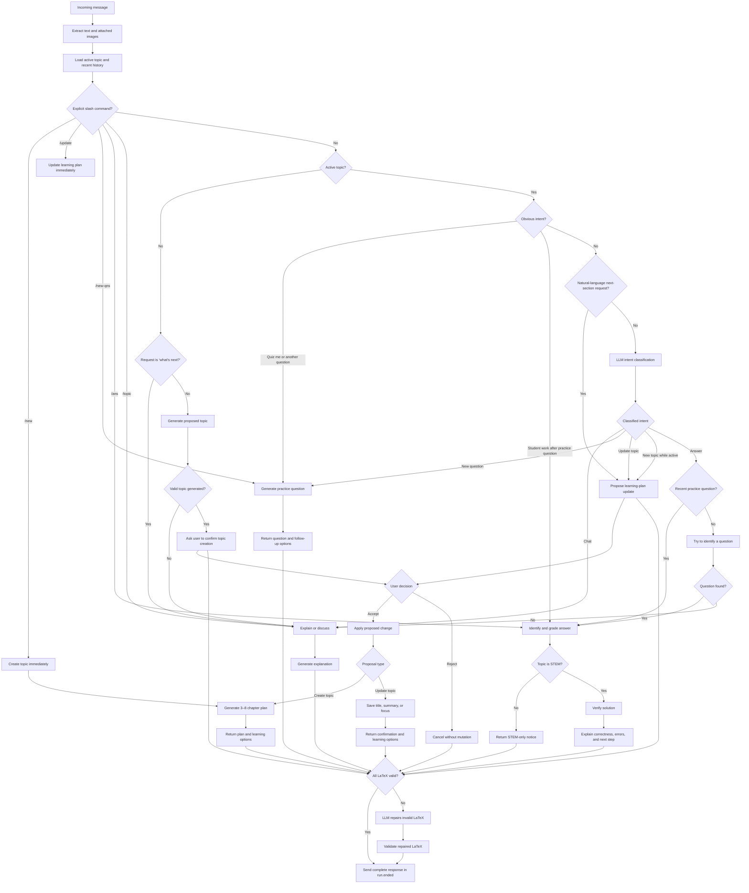

# Agent decision tree

This document describes the current `edu-api` chat-agent routing behavior. Keep it updated whenever routing, confirmation, generation, or validation behavior changes.

## Response delivery

- Progress events may still be sent while the agent works.
- Response text is not exposed through `run.delta` events.
- The client receives the complete response in a single `run.ended` event.

## Final-response validation

Before persistence and delivery, every text part is checked for inline `$...$`, display `$$...$$`, and fenced `latex` or `tex` blocks. KaTeX validates each extracted expression. If validation fails, the agent makes one non-streaming repair call and uses the corrected response only if it passes validation.

## Diagram output

When a student asks for a diagram, visualization, state machine, flowchart, graph, or process map, the response-generation prompt instructs the agent to return valid Mermaid inside a fenced `mermaid` block. It must not substitute ASCII art for the diagram.
