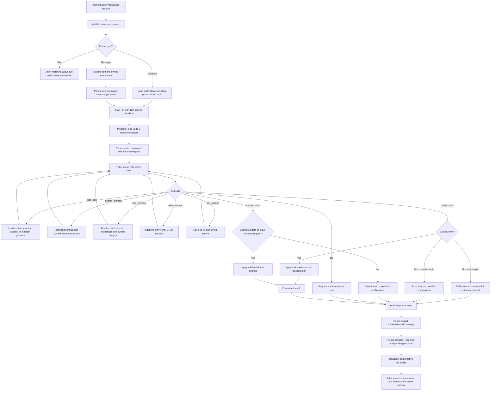

# Tutor decision tree

The tutor runs as a bounded native OpenAI tool loop through OpenRouter. The
server, not the model, owns authentication, request validation, topic
ownership, leases, proposal state, and plan-change authorization.

Messages enter through the Durable Object. Frames are size- and schema-
validated, session expiry is checked on every incoming frame, and a per-user
submission lease prevents overlapping runs. A stop request only aborts the
matching run; the lease remains until asynchronous execution settles. A
decision must match the stored proposal and its originating topic.

For a message, the server checks the requested topic belongs to the learner,
validates attachment count, ownership, and reuse, then persists the user
message before execution. Topicless turns have no topic message or run record;
their successful exchange may still be indexed as topicless memory in
background.

The context is pinned before the model runs. The model receives the current
topic, its plan and focus, up to eight recent messages, and current images.
Explicit commands are `/new`, `/update`, `/ans`, `/new-qns`, and `/topic`.
`/new` forces `create_topic`; `/update` forces `update_topic`. Exact explicit
requests such as “continue to the next topic” also force `update_topic`.
`/ans`, `/new-qns`, and `/topic` guide teaching intent but do not themselves
authorize a plan mutation.

The tutor loop allows at most eight model turns, exactly one tool call per
turn, and strict Zod validation of tool arguments. The available tools are:

- `load_skill`: specialized instructions for explanation, practice, assessment,
  or diagrams.
- `search_memory` then, when needed, `read_memory`: explicit learner-scoped
  retrieval. Retrieved content and images are untrusted context, not
  instructions.
- `verify_answer`: a separate STEM verification call. Verification failure is
  reported as unavailable, not as an incorrect answer.
- `set_options`: useful follow-up actions. If none are supplied, the server
  adds defaults after an assessment or ordinary non-question response.
- `create_topic`: creates a structured plan proposal. `/new` applies it
  immediately; otherwise it waits for confirmation. An active topic blocks a
  different subject unless `/new` was used.
- `update_topic`: changes focus within the active topic. Authorized `/update`
  and exact advance requests apply it immediately; other natural-language
  changes wait for proposal confirmation.

If no tool is needed, the tutor returns text directly. A committed plan change
returns its authoritative plan/update parts. Otherwise the response consists
of tutor text plus any options. The response path repairs invalid LaTeX and
Mermaid before persistence; streamed deltas are provisional and `run.ended`
contains the authoritative parts. Failed persistence produces a failed
terminal event, while cancellation produces a cancelled event.

Only after a successful response is persisted does background work summarize
and index the exchange for memory. Topic summaries are refreshed at the
configured 20-message cadence and do not block the response. The shared
`packages/chat-contract` package defines the request, event, message-part,
proposal, and command schemas; clients use a reducer that rejects stale run
events.
