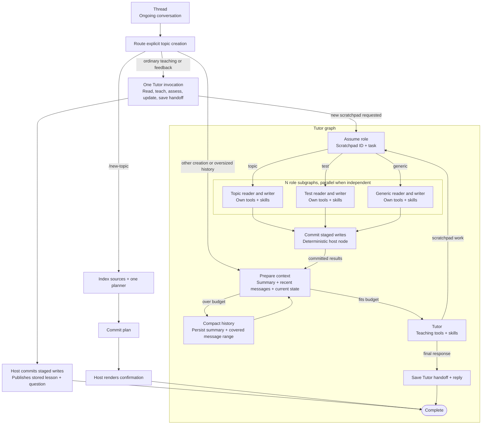

# Tutor graph design

Status: implemented. `desktop/src/runners/tutor-graph.ts` defines the workflow. `desktop/src/main/tutor-workflow.ts` enforces its storage and permission contracts.

An ongoing chat invokes one workflow for each learner turn. Tutor completes ordinary teaching and feedback in one native invocation. New scratchpad creation uses isolated role subgraphs. EdU manages context, checkpoints, role permissions, and durable commits. Codex, Claude Code, or Antigravity executes each Tutor or role task.

## Topic creation

Explicit `/new-topic` requests use the indexed creation flow in [Topic creation flow](topic_creation_flow.md). They route directly to one planner. Document OCR and indexing are local, cached operations. The host constructs citations from selected section IDs, commits the plan, and renders confirmation without resuming Tutor. Conversational creation still uses Tutor for intent identification, then the same planner. Confirmed teaching uses the single-invocation path below.

## Graph

The role branches select the appropriate type for each job. A batch can contain several jobs of the same type. Commit waits for every required job in that batch.

## Ordinary response latency

Confirmed teaching, feedback, and ordinary chat route through `single_tutor`. Tutor reads sources, updates scratchpads, records the next dynamic question, and saves the private handoff in one native invocation. The host stages each mutation before reporting tool success. `single_publish` commits those stages and saves the handoff and reply. Checkpointing the model result before publication lets Retry finish publication without generating the lesson again.

When `present` selects stored lesson blocks and the handoff is valid, the adapter ends generation and publishes those blocks with the recorded question. It does not ask a separate role for a summary or ask Tutor to rewrite the lesson.

Codex conversation IDs are retained in the committed turn and restored on the next turn. Resumption requires matching tool schemas, executable, home, and tool version; incompatible scopes start fresh. A resumed turn sends only the new learner message. Interrupted invocations reconstruct from durable state rather than blindly replaying the native conversation.

Production traces on 2026-10-25 showed 111.9s and 93.6s responses using three sequential fresh sessions: routing Tutor, teaching role, then final Tutor. Planning was a separate 27.0s turn with one planner. The single-invocation path removes the two extra teaching calls and avoids storing repeated prepared copies of source data for ordinary turns.

A replay through Electron, the real worker, and Codex on a SQLite backup of the production workspace used the original request and pre-turn scratchpad state with `gpt-6.1-sol` at low reasoning effort. The first single-invocation replay took 51.9s. It exposed a second regression: an answer write and lesson edits were rejected until every page in the curriculum part had been reread. Recording an answer must not depend on rereading the whole source range. The corrected replay took 36.5s with one invocation and zero failed tool calls, compared with the recorded 93.6s turn. About 32.2s remained inside the native model turn; these are individual measurements, not latency guarantees. A subsequent live follow-up confirmed `resumed: true`.

A later production turn took 173.7s because the running `release/mac-arm64/EdU.app` still contained the earlier worker. Its archive had no `single_tutor` node or tool-version-24 resumption support, although the development build did. The trace contained seven fresh native sessions: initial routing, teaching, two additional delegation loops to redisplay existing blocks, and final reply generation. The first lesson and question writes completed about 55s into the turn.

Replaying that exact 173.7s request and its pre-turn state through the rebuilt packaged worker on a workspace backup took 53.2s, using one native invocation and zero prepared-context copies. This is one cold-session sample; it still exceeds the historical 30–40s baseline. The verified package replaced the running stale application after confirming no learner turn was active.

`test:packaged` now runs the Electron workflow fixture against the worker inside the actual application archive, as well as the packaged OCR smoke test. The stale archive fails the teaching assertion with three invocations instead of one. A development `build` updates `out`; `package:dir` updates the application under `release`. An already-running packaged application needs the updated package and a restart.

Grounding checks apply when changing curriculum references or adding explicit source blocks. Ordinary progress writes do not revalidate unchanged curriculum citations. The model reads the source pages needed for the current explanation and question. The source-free planner's inspected-section requirement remains unchanged.

### Mixed topics and streaming

A confirmed topic stays on the single-invocation route when the chat also contains an unrelated draft. Routing checks the current message's mentions, open topic, confirmation target, and pending question. Inherited draft topics remain readable without receiving teaching write grants. A request targeting the draft still requires planning or confirmation.

New explanations stream as normal learner-facing response text. The host stores that same response as a markdown block for the active topic before committing the turn. It checkpoints the generated result first, so a publication retry neither regenerates nor duplicates the lesson. Explicit edits can still select existing stored blocks with `present`.

Response previews are provisional and do not require the final private handoff. Final publication still requires valid saved progress and a committed batch. Role summaries remain hidden. Native text deltas pass through the worker and `runtime.reply` to the renderer. Creating explanations only inside tool arguments cannot produce learner-facing text deltas, so normal teaching avoids that path.

On 2026-10-25, a 124.9s teaching turn exposed the mixed-topic routing bug: an unrelated unconfirmed topic forced three sessions. The earlier source and packaged tests covered only a single confirmed topic. Regression coverage now includes the mixed-topic Electron path, native incremental previews before handoff, and retry-safe storage of streamed lesson text. Replaying that exact turn through the rebuilt packaged worker produced first visible text at 23.0s and completed at 53.6s, using one invocation. Incremental preview lengths increased while the turn was running. These are single-run measurements on a workspace backup.

## Ownership

| Component | Responsibility |
| --- | --- |
| Thread | Stores the ongoing conversation, learner state, and references to turn workflows. |
| LangGraph workflow | Routes decisions, schedules role jobs, joins results, checkpoints progress, and resumes failed work. |
| Tutor | Chooses teaching actions, requests scratchpad tasks, and produces the learner reply and handoff. |
| Role subgraph | Handles one bounded scratchpad task using its own context, skills, and tools. |
| Native runner | Reasons and chooses tools within the capabilities supplied to its invocation. |
| EdU host | Enforces permissions, builds context, stores stages, validates writes, and commits application state. |

The native runners retain their internal agent loops. LangGraph owns delegation and workflow progression, including the mandatory commit after role work.

### Tools and skills

| Scope | Tools | Skills |
| --- | --- | --- |
| Single-invocation Tutor | Material access, tagged scratchpad readers and writers, teaching tools, `save_learning_state`, and delegation for new scratchpads. | Teaching and matching scratchpad management guidance. |
| Creation coordinator | Material access, tutoring-only `read_skill`, `assume_role`, and `save_learning_state`. | Explanation, understanding, feedback, deliberate practice, and writing guidance. |
| Topic role | Scoped topic readers and writers, plus explicitly granted material and dependency reads. | `MANAGE_TOPIC` and topic templates. |
| Test role | Scoped test readers and writers, plus explicitly granted topic evidence and material reads. | `MANAGE_TEST` and test templates. |
| Generic role | Scoped generic scratchpad readers and writers, plus explicitly granted dependency reads. | `MANAGE_GENERIC` and generic templates. |

The single-invocation Tutor receives current tagged scratchpad state and the matching reader and writer tools. Creation tools remain delegated. The delegation coordinator receives a directory and concise summaries; isolated creation roles receive their own state, management guides, and granted tools.

Skills provide instructions. Host tool handlers enforce access on every call, including `read_skill`. A role name or prompt alone does not establish isolation.

## Identities and node contracts

| Identifier | Meaning |
| --- | --- |
| `chatId` | The ongoing Tutor conversation across learner messages. |
| `turnId` | One learner turn's workflow. Used as LangGraph `thread_id`. |
| `tutorStepId` | One Tutor invocation within that workflow. |
| `batchId` | A group of independent role jobs. |
| `jobId`, `stageId` | One role task and its durable staging record. |
| `contextVersion` | An immutable prepared context version used by an invocation. |
| Provider session ID | The runner's conversation identity, tracked separately from graph IDs. |

The table describes the logical node contracts. Runtime schemas live in `desktop/src/shared/tutor-workflow.ts`. Graph checkpoints carry identities and decisions. The host resolves durable contexts, jobs, stages, and receipts.

| Boundary | Input | Output |
| --- | --- | --- |
| Thread to workflow | `chatId`, `turnId`, `learnerMessageId`, `runnerId` | Initial workflow state and durable input references. |
| Prepare context | Turn identity, pinned conversation and application-state references, summary version, and committed batch references. | Prepared Tutor context with `contextVersion`, summary, recent messages, learner state, scoped directory, materials, skills, tools, and budget decision. |
| Compact history | Prepared context, eligible source message range, and context budget. | Durable summary reference, covered-through message ID, and new `contextVersion`. |
| Tutor | Prepared context, `tutorStepId`, and runner configuration. | Either `{ action: "delegate", requests }` or `{ action: "reply", reply, handoffRef }`. The host attaches the verified `handoffRef`. |
| Assume role | Turn identity, `tutorStepId`, and requests containing target, task, requested access, relevant context, and read dependencies. | Host-issued `batchId` and jobs containing `jobId`, `stageId`, resolved target, stored role, granted access, base version, and task. |
| Topic, test, or generic role | Assigned job, target snapshot, dependency grants, role skills, and tool allowlist. | Host-validated `{ turnId, batchId, jobId, stageId, status: "ready", summary, evidence }`. |
| Commit staged writes | `{ turnId, batchId }`. | Durable batch receipt and committed results containing job and scratchpad identities, versions, summaries, and evidence. |
| Save Tutor handoff + reply | `{ chatId, turnId, reply, handoffRef }`. | Durable turn receipt with assistant message ID and committed batch receipt IDs. |
| Complete | `{ chatId, turnId }`. | The persisted assistant message and verified turn receipt. |

Models produce task requests, summaries, evidence, and replies. The host assigns identities, grants permissions, verifies stages, and creates receipts. Schema validation alone does not establish authorization or prove that writes committed.

## Context and compaction

The chat continues across turns. A new graph workflow does not reset the conversation. EdU builds the context sent to each Tutor invocation from durable conversation records and current workflow results.

Prepare context runs at turn entry and after each committed delegation batch. The input budget includes instructions, skill content, tool schemas, and messages, with room reserved for tool results and the response.

When the input exceeds its budget, Compact history summarizes eligible conversation history and persists the summary with its source message range. Prepare context then rebuilds and checks the input. Recent messages, pending work, and required tool-call relationships remain available. Original messages remain stored.

Compaction preserves learning objectives, pending questions, preferences, decisions, and unresolved work. Structured learner state, scratchpads, stages, and commit receipts remain authoritative. Private assessment answers enter only contexts that need them.

If fixed instructions, tools, or required current content exceed the budget, the host narrows that content or returns an error. Repeated summarization cannot solve that case.

Cross-turn summaries belong to `chatId` in application storage. Each workflow pins its source references and context versions for recovery. Context preparation includes completed work from that workflow without admitting newer learner messages during a retry.

The runner adapter must use the prepared context. After compaction, the adapter must rebuild or rebase a native session from that context. Appending a summary to an unchanged full native transcript does not reduce its size. The logical chat retains its identity even if the provider session changes.

EdU controls compaction between graph nodes. Context growth inside an opaque native invocation remains runner-managed. Each role has a separate context and can use the same preparation and compaction pattern at its own graph boundaries. Provider support and compaction thresholds require validation during implementation.

## Delegation and isolation

`assume_role` is an executable delegation request. Tutor uses this tool to create a scratchpad. Ordinary teaching, recording an answer, and retrieving current learning position use the tools already granted to the single tutoring invocation. Task text cannot grant permissions.

The host resolves an existing scratchpad's role from its stored type. For creation, the host allocates a stable scratchpad identity before invoking the requested creation role. It grants tools, skill access, materials, and read dependencies for that job.

Each job uses a separate runner context and a per-invocation subgraph checkpoint namespace. Independent scratchpads can run in parallel. Writes to the same scratchpad require serialization and version checks. Dependent tasks run in later batches after their prerequisites finish.

Tutor yields a delegation decision so the graph can checkpoint and schedule the batch. Adapters need a bounded yield and resume contract or equivalent batch protocol. Child execution must remain graph-visible rather than disappear inside an untracked native tool callback.

## Staging and guaranteed commit routing

Role writer tools apply validated mutations to durable staged state. Each stage records its job, target, base version, ordered operations, and read evidence. The role model returns a summary and evidence. The host marks the role ready only after validating the actual stage.

Commit loads every required stage from the persisted batch record. Its input contains only `turnId` and `batchId`, so Tutor cannot omit writes by returning a selected mutation list.

Commit performs the following work in one application transaction:

1. Return the existing receipt if the batch already committed.
2. Verify the expected jobs, stage ownership, permissions, and revision preconditions.
3. Apply all validated batch mutations and record the batch receipt.

Read-only batches also produce a receipt, with no scratchpad mutations. Creation retries reuse the host-allocated target identity.

Every successful role batch routes through Commit before results return to Tutor. A commit failure prevents that transition. Save Tutor handoff + reply verifies that all required batches committed, then persists the handoff, assistant message, and turn receipt atomically. Complete requires that receipt.

This guarantees that successful completion requires persisted commits. It does not guarantee that invalid work eventually succeeds.

Scratchpad changes commit per delegation batch. If Tutor later fails to produce its reply, those changes remain committed. A retry resumes reply work without applying the batch again.

## Checkpoints and retry

Use a persistent checkpointer and synchronous durability at the workflow boundaries. A full checkpoint records graph state and pending work after each super-step. Parallel jobs share a super-step, while completed job outputs can persist as pending writes before the full checkpoint completes.

Role subgraphs have their own internal checkpoint boundaries. Tool calls inside a native runner node do not automatically create graph checkpoints. Checkpoints store durable references and workflow data, not subprocess handles, functions, or credentials.

The Retry action targets the specific failed `turnId`. The host validates ownership and resumes its latest pending checkpoint with the same `thread_id`, rather than submitting a new learner turn. A typed "retry" request needs the same failed-turn resolution.

Recovery reuses completed role outputs and saved context versions. If a transaction committed before its following graph checkpoint, its receipt makes replay safe. Stable logical operation IDs prevent repeated staged operations. Provider tool-call IDs alone are insufficient for that purpose.

Before restarting uncertain native work, the host reconciles the provider's status and prevents the old attempt from continuing to write. An unresolved native request cannot be treated as safe to repeat. Permission, validation, and revision failures require correction rather than blind retries.

A workflow that ended successfully after catching an error has no pending failed node to resume. That case requires an explicit recovery transition.

## Implementation checks

- `pnpm --dir desktop test` exercises repository transactions, scoped sessions, compaction, parallel recovery, and the Codex protocol adapter.
- `pnpm --dir desktop test:electron` exercises Send and Retry through a real Electron worker and MCP transport with a scripted provider process.
- `pnpm --dir desktop typecheck` checks the application and test harness.

The default context budget is 120,000 tokens, with 20,000 reserved for results and output. Text uses a conservative UTF-8 byte count. Each attached image reserves another 12,000 tokens. Compaction keeps the latest eight messages. Oversized required content fails with a narrowing request.

Native adapters reconstruct each invocation from its prepared context. The ongoing chat retains its ID and full stored history. EdU records provider subprocess identities for recovery. Retry refuses an uncertain attempt whose process status cannot be reconciled. Live Codex, Claude Code, and Antigravity model behavior and provider context limits still need validation with connected accounts.

## References

- [LangGraph checkpoint boundaries and durability](https://docs.langchain.com/oss/javascript/langgraph/checkpointers)
- [LangGraph subgraphs and invocation scope](https://docs.langchain.com/oss/javascript/langgraph/use-subgraphs)
- [LangChain context trimming and summarization](https://docs.langchain.com/oss/javascript/langchain/short-term-memory)
