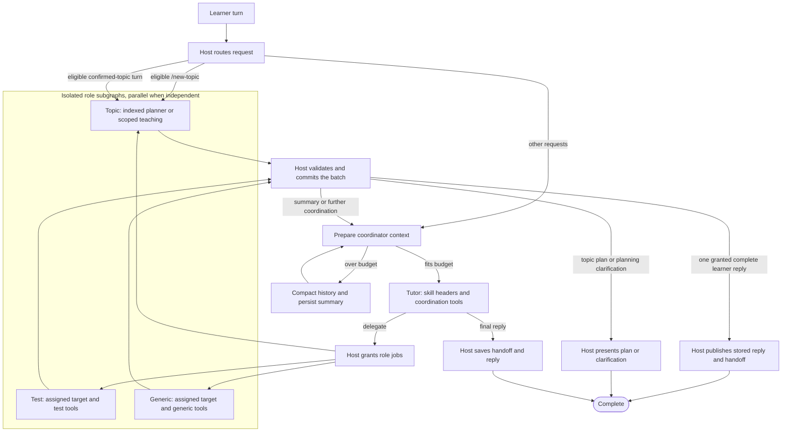

# Tutor graph design

Status: implemented. `desktop/src/runners/tutor-graph.ts` defines the workflow. `desktop/src/main/tutor-workflow.ts` enforces its storage and permission contracts.

An ongoing chat invokes one workflow for each learner turn. The host routes eligible confirmed-topic turns directly to a topic role. Tutor coordinates other requests and assumes a scratchpad role for every scratchpad read or write. Each role subgraph has its own model context, management instructions, and tool grants. The host checkpoints results and commits staged writes before publishing them.

## Topic creation

Explicit `/new-topic` requests use the indexed creation flow in [Topic creation flow](topic_creation_flow.md). The host assumes the topic planning role directly. Document OCR and indexing are local, cached operations. The host constructs citations from selected section IDs, commits the plan, and renders confirmation without another Tutor invocation. Conversational creation uses Tutor to establish intent before assuming the role.

## Graph

Direct routes create host-granted jobs and enter the same topic role subgraph used by Tutor delegation. Each role runs preparation, native execution, and validation before commit. Commit waits for every required job in the batch. Context preparation and history compaction run before coordinator invocations. Original conversation records remain stored.

## Ordinary response latency

An eligible confirmed-topic turn uses one topic-role invocation, followed by commit and `presentRoleReply`. The host skips the routing Tutor invocation and publishes the role's stored response without a final Tutor rewrite.

The direct route requires exactly one selected, unarchived, confirmed topic, no scratchpad command or creation request, and bounded conversation context. Topic selection uses explicit mentions, the confirmation target, a pending check, the opened topic, and recent message targets. An unrelated draft does not prevent routing to the selected confirmed topic.

The route requires a summary of at most 20,000 characters. The serialized messages, learner state, and summary must fit within half the available input budget in UTF-8 bytes. Larger contexts return through coordinator preparation and compaction. Explicit `/new-topic` instructions route directly only when nonempty and at most 20,000 characters.

If a direct role needs another target or ungranted dependencies, it calls `finish_role` with `needsCoordination` before staging any writes. The host records the result and commits the empty batch, then returns to Tutor for coordination.

`desktop/src/runners/topic-continuation.test.ts` verifies that a confirmed-topic continuation uses one role invocation and no coordinator invocation. Historical latency measurements for the retired `single_tutor` path do not measure the current role path.

On 2026-10-26, an isolated replay of the captured section 6.2 teaching request completed in 52.3 seconds with one `gpt-6.1-sol` invocation and the same source assets. The original run was stopped at 130.5 seconds, including 68.8 seconds in the routing model before teaching began. The replay preserved the earlier answer, source references, pending check, and unfinished section 6.1 coverage. This is one comparison, not a latency guarantee.

## Skills and role context

Tutor receives the name, description, and path of each teaching skill. It reads the body through `read_skill` when the description matches the task. Its initial directory contains the current targets; `list_scratchpads` discovers other handles through paginated metadata.

Assuming a role enters its subgraph and injects that role's `MANAGE_TOPIC`, `MANAGE_TEST`, or `MANAGE_GENERIC` instructions. General teaching and writing skills remain header entries. Templates and schema references load through `read_skill` on demand. The host rejects skills, tools, materials, and scratchpads outside the role's grants.

Roles receive the requested learner messages, assigned target, granted dependencies, and a compact current-state view. `read_topic_evidence` retrieves section history in bounded pages. Test discovery uses `test_getCoveredTopics` summaries before reading detailed evidence. Existing tests retain their saved source topics.

## Completing a role response

Tutor can request `replyToLearner: true` for one independent write job that can finish the learner turn. The host rejects this flag on read-only or multi-job batches. The role stages its changes, saves a validated private handoff, and writes the learner-facing response. It can also finish with explicitly selected stored lesson blocks.

The role result persists before commit. After commit, `presentRoleReply` saves the handoff and publishes that result without asking Tutor to rewrite it. Response content and private handoffs stay out of the batch summaries returned to Tutor. Summary-only jobs and tasks requiring more coordination return through the coordinator instead.

New turns always execute scratchpad work through role subgraphs. The retired `single_tutor` and `single_publish` node names remain only to recover older checkpoints. Pending legacy work resumes inside its assigned role; already generated legacy output can finish publication without another model run.

## Streaming and runtime updates

Only learner-facing coordinator or explicitly granted role responses produce provisional previews. Role summaries remain hidden. Final publication requires committed writes and a validated handoff.

The worker coalesces text deltas, and the main process publishes runtime-only updates at a 40 ms interval. Diagnostic events still append to the complete trace. Runtime updates retain existing workspace objects in the renderer. Durable changes send a full snapshot and cancel any pending runtime update so the final state stays current.

The snapshot builder and runner-status reader copy runner records directly instead of cloning the entire workspace to obtain runners. Runtime events never rebuild the topic and chat projections.

## Ownership

| Component | Responsibility |
| --- | --- |
| Thread | Stores the ongoing conversation, learner state, and references to turn workflows. |
| LangGraph workflow | Routes decisions, schedules role jobs, joins results, checkpoints progress, and resumes failed work. |
| Tutor | Chooses teaching actions, requests scratchpad tasks, and produces the learner reply and handoff. |
| Role subgraph | Handles one bounded scratchpad task using its own context, skills, and tools. |
| Native runner | Reasons and chooses tools within the capabilities supplied to its invocation. |
| EdU host | Enforces permissions, builds context, stores stages, validates writes, and commits application state. |

The native runners retain their internal agent loops. LangGraph owns delegation and workflow progression, including the mandatory commit after role work.

### Tools and skills

| Scope | Tools | Skills |
| --- | --- | --- |
| Tutor coordinator | Material access, `list_scratchpads`, teaching-only `read_skill`, `assume_role`, and `save_learning_state`. | Teaching skill headers; bodies load on demand. |
| Topic role | Scoped topic readers and writers, plus explicitly granted material and dependency reads. | `MANAGE_TOPIC` on entry; general skills and topic templates on demand. |
| Test role | Scoped test readers and writers, plus explicitly granted topic evidence and material reads. | `MANAGE_TEST` on entry; general skills and test templates on demand. |
| Generic role | Scoped generic scratchpad readers and writers, plus explicitly granted dependency reads. | `MANAGE_GENERIC` on entry; general skills and generic templates on demand. |

The coordinator receives current target metadata and committed summaries. Roles receive only their assigned state, management guide, and granted tools. A role can save a private handoff only when explicitly granted a direct learner response.

Skills provide instructions. Host tool handlers enforce access on every call, including `read_skill`. A role name or prompt alone does not establish isolation.

## Identities and node contracts

| Identifier | Meaning |
| --- | --- |
| `chatId` | The ongoing Tutor conversation across learner messages. |
| `turnId` | One learner turn's workflow. Used as LangGraph `thread_id`. |
| `tutorStepId` | One Tutor invocation within that workflow. |
| `batchId` | A group of independent role jobs. |
| `jobId`, `stageId` | One role task and its durable staging record. |
| `contextVersion` | An immutable prepared context version used by an invocation. |
| Provider session ID | The runner's conversation identity, tracked separately from graph IDs. |

The table describes the logical node contracts. Runtime schemas live in `desktop/src/shared/tutor-workflow.ts`. Graph checkpoints carry identities and decisions. The host resolves durable contexts, jobs, stages, and receipts.

| Boundary | Input | Output |
| --- | --- | --- |
| Thread to workflow | `chatId`, `turnId`, `learnerMessageId`, `runnerId` | Initial workflow state and durable input references. |
| Prepare context | Turn identity, pinned conversation and application-state references, summary version, and committed batch references. | Prepared Tutor context with `contextVersion`, summary, recent messages, learner state, scoped directory, materials, skills, tools, and budget decision. |
| Compact history | Prepared context, eligible source message range, and context budget. | Durable summary reference, covered-through message ID, and new `contextVersion`. |
| Tutor | Prepared context, `tutorStepId`, and runner configuration. | Either `{ action: "delegate", requests }` or `{ action: "reply", reply, handoffRef }`. The host attaches the verified `handoffRef`. |
| Assume role | Turn identity, `tutorStepId`, and requests containing target, task, requested access, relevant context, and read dependencies. | Host-issued `batchId` and jobs containing `jobId`, `stageId`, resolved target, stored role, granted access, base version, and task. |
| Topic, test, or generic role | Assigned job, target snapshot, dependency grants, role skills, and tool allowlist. | Host-validated `{ turnId, batchId, jobId, stageId, status: "ready", summary, evidence }`. |
| Commit staged writes | `{ turnId, batchId }`. | Durable batch receipt and committed results containing job and scratchpad identities, versions, summaries, and evidence. |
| Save Tutor handoff + reply | `{ chatId, turnId, reply, handoffRef }`. | Durable turn receipt with assistant message ID and committed batch receipt IDs. |
| Complete | `{ chatId, turnId }`. | The persisted assistant message and verified turn receipt. |

Models produce task requests, summaries, evidence, and replies. The host assigns identities, grants permissions, verifies stages, and creates receipts. Schema validation alone does not establish authorization or prove that writes committed.

## Context and compaction

The chat continues across turns. A new graph workflow does not reset the conversation. EdU builds the context sent to each Tutor invocation from durable conversation records and current workflow results.

Prepare context runs at turn entry and after each committed delegation batch. The input budget includes instructions, skill content, tool schemas, and messages, with room reserved for tool results and the response.

When the input exceeds its budget, Compact history summarizes eligible conversation history and persists the summary with its source message range. Prepare context then rebuilds and checks the input. Recent messages, pending work, and required tool-call relationships remain available. Original messages remain stored.

Compaction preserves learning objectives, pending questions, preferences, decisions, and unresolved work. Structured learner state, scratchpads, stages, and commit receipts remain authoritative. Private assessment answers enter only contexts that need them.

If fixed instructions, tools, or required current content exceed the budget, the host narrows that content or returns an error. Repeated summarization cannot solve that case.

Cross-turn summaries belong to `chatId` in application storage. Each workflow pins its source references and context versions for recovery. Context preparation includes completed work from that workflow without admitting newer learner messages during a retry.

The runner adapter must use the prepared context. After compaction, the adapter must rebuild or rebase a native session from that context. Appending a summary to an unchanged full native transcript does not reduce its size. The logical chat retains its identity even if the provider session changes.

EdU controls compaction between graph nodes. Context growth inside an opaque native invocation remains runner-managed. Each role has a separate context and can use the same preparation and compaction pattern at its own graph boundaries. Provider support and compaction thresholds require validation during implementation.

## Delegation and isolation

`assume_role` is an executable delegation request for scratchpad reads, writes, and creation. Ordinary teaching that updates a scratchpad enters the matching role subgraph. Task text cannot grant permissions.

The host resolves an existing scratchpad's role from its stored type. For creation, the host allocates a stable scratchpad identity before invoking the requested creation role. It grants tools, skill access, materials, and read dependencies for that job.

Each job uses a separate runner context and a per-invocation subgraph checkpoint namespace. Independent scratchpads can run in parallel. Writes to the same scratchpad require serialization and version checks. Dependent tasks run in later batches after their prerequisites finish.

Tutor yields a delegation decision so the graph can checkpoint and schedule the batch. Adapters need a bounded yield and resume contract or equivalent batch protocol. Child execution must remain graph-visible rather than disappear inside an untracked native tool callback.

## Staging and guaranteed commit routing

Role writer tools apply validated mutations to durable staged state. Each stage records its job, target, base version, ordered operations, and read evidence. The role model returns a summary and evidence. The host marks the role ready only after validating the actual stage.

Commit loads every required stage from the persisted batch record. Its input contains only `turnId` and `batchId`, so Tutor cannot omit writes by returning a selected mutation list.

Commit performs the following work in one application transaction:

1. Return the existing receipt if the batch already committed.
2. Verify the expected jobs, stage ownership, permissions, and revision preconditions.
3. Apply all validated batch mutations and record the batch receipt.

Read-only batches also produce a receipt, with no scratchpad mutations. Creation retries reuse the host-allocated target identity.

Every successful role batch routes through Commit before results return to Tutor. A commit failure prevents that transition. Save Tutor handoff + reply verifies that all required batches committed, then persists the handoff, assistant message, and turn receipt atomically. Complete requires that receipt.

This guarantees that successful completion requires persisted commits. It does not guarantee that invalid work eventually succeeds.

Scratchpad changes commit per delegation batch. If Tutor later fails to produce its reply, those changes remain committed. A retry resumes reply work without applying the batch again.

## Checkpoints and retry

Use a persistent checkpointer and synchronous durability at the workflow boundaries. A full checkpoint records graph state and pending work after each super-step. Parallel jobs share a super-step, while completed job outputs can persist as pending writes before the full checkpoint completes.

Role subgraphs have their own internal checkpoint boundaries. Tool calls inside a native runner node do not automatically create graph checkpoints. Checkpoints store durable references and workflow data, not subprocess handles, functions, or credentials.

The Retry action targets the specific failed `turnId`. The host validates ownership and resumes its latest pending checkpoint with the same `thread_id`, rather than submitting a new learner turn. A typed "retry" request needs the same failed-turn resolution.

Recovery reuses completed role outputs and saved context versions. If a transaction committed before its following graph checkpoint, its receipt makes replay safe. Stable logical operation IDs prevent repeated staged operations. Provider tool-call IDs alone are insufficient for that purpose.

Before restarting uncertain native work, the host reconciles the provider's status and prevents the old attempt from continuing to write. An unresolved native request cannot be treated as safe to repeat. Permission, validation, and revision failures require correction rather than blind retries.

A workflow that ended successfully after catching an error has no pending failed node to resume. That case requires an explicit recovery transition.

## Implementation checks

- `pnpm --dir desktop test` exercises repository transactions, scoped sessions, compaction, parallel recovery, and the Codex protocol adapter.
- `pnpm --dir desktop test:electron` exercises Send and Retry through a real Electron worker and MCP transport with a scripted provider process.
- `pnpm --dir desktop typecheck` checks the application and test harness.

The default context budget is 120,000 tokens, with 20,000 reserved for results and output. Text uses a conservative UTF-8 byte count. Each attached image reserves another 12,000 tokens. Compaction keeps the latest eight messages. Oversized required content fails with a narrowing request.

Native adapters reconstruct each invocation from its prepared context. The ongoing chat retains its ID and full stored history. EdU records provider subprocess identities for recovery. Retry refuses an uncertain attempt whose process status cannot be reconciled. Live Codex, Claude Code, and Antigravity model behavior and provider context limits still need validation with connected accounts.

## References

- [LangGraph checkpoint boundaries and durability](https://docs.langchain.com/oss/javascript/langgraph/checkpointers)
- [LangGraph subgraphs and invocation scope](https://docs.langchain.com/oss/javascript/langgraph/use-subgraphs)
- [LangChain context trimming and summarization](https://docs.langchain.com/oss/javascript/langchain/short-term-memory)
