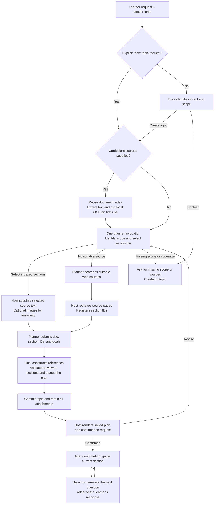

# Topic creation flow

Status: implemented. The explicit creation path uses one planner invocation, a cached document index, host-owned citations, and a confirmation reply rendered from the committed plan.

## Pipeline

Select, research, and submit are steps within the same planner invocation. There are no separate model readers for curriculum sections and no model call to present the saved plan.

## Intent and routing

An explicit `/new-topic` request with a nonempty instruction routes directly to the planner. The planner clarifies missing subject, scope, or learner information before submitting a topic. An empty command returns to Tutor for clarification. Requests too large for the direct task boundary use the normal context preparation path.

Conversational creation requests still use Tutor to identify intent and delegate planning. Eligible confirmed-topic turns route directly to one isolated topic role with scoped teaching tools and durable staged writes. Other requests use Tutor for coordination. Both creation routes use the same planner and commit contracts.

Explicit topic creation also skips model-generated chat naming. The committed topic supplies the chat title when the chat has no established title.

## Document preparation and caching

`material-extraction.ts` extracts embedded text when attachments are imported. For PDF pages with little embedded text, it renders the pages and runs local Tesseract OCR. Image attachments also use OCR. The English language data is bundled, so indexing needs neither a model request nor a runtime language download.

Up to three local OCR workers process pages. These are worker threads, not LLM agents. Extraction results and the document index are cached by file content and extraction version. Changed file bytes invalidate the cache. Existing attachments without an index are prepared on first planning use.

The index records numbered headings, continuation ranges, and stable section IDs. When no numbered headings are available, page entries provide selectable source units. OCR supports navigation and planning. Ambiguous headings and figures can still require inspection of the original images. Detailed teaching can use the cached text and original source pages.

The planner receives the index, selects the requested sections together, and gets their text through `select_topic_sections`. It cannot request arbitrary page ranges. Each selected range retains its continuation pages. Source images enter the planner context only when requested to resolve ambiguity.

## Practice attachments

Tutorials, worksheets, problem sets, practice sheets, and assignments are identified from filenames and opening source text. When a separate curriculum source exists, these attachments remain available for teaching without entering the planner's curriculum section list. If the only supplied source is a worksheet, it can itself define the requested curriculum.

All supplied attachments are retained when the topic commits. Retention requires no curriculum citation, exercise mapping, or extra model invocation. The tutor selects relevant practice material dynamically during teaching.

## Research without supplied sources

The same planner uses the provider's native web search to find suitable official documentation, textbooks, university materials, or primary publications. It then calls `inspect_web_source` for candidate pages.

The host retrieves readable source content and registers a section ID for each inspected page. A search-result URL alone is insufficient. Plans select these IDs, and the host constructs the corresponding web references.

The planner is instructed to use at most two search rounds. The host permits up to eight source-page inspections, with bounded response size and request duration. Missing or inaccessible coverage returns through `request_topic_clarification` without a topic or a dangling topic reference.

## Plan submission and references

`submit_topic_plan` accepts a title and ordered sections with learning goals. Each section identifies a reviewed source section by ID. Optional names can clarify source headings. Plans contain at most three goals per section.

File paths, page ranges, reference objects, topic identities, and part identities are constructed by the host. Raw reference fields are rejected. Unknown or unread section IDs cannot be submitted. The planner therefore cannot cite an unread tutorial page by inventing its page range.

The host stages the validated topic and ends the planner invocation immediately. Commit remains a durable graph step. Recovery can reuse an already staged plan without invoking the planner again.

## Confirmation and teaching

After commit, `presentPlan` builds the reply from the saved curriculum, goals, and source references. It saves the private handoff and assistant message with `awaiting_plan_confirmation`. The message retains the measured turn duration. Replaying presentation returns the existing receipt and message.

A plan revision uses the same planner. Teaching mutations remain blocked until learner confirmation. Eligible confirmed-topic turns use one topic-role invocation to read sources, teach, record progress and dynamic questions, and save the private handoff. New explanations stream as response text, which the host saves into the active topic before publishing. Explicit edits can present existing lesson blocks. The host commits and publishes the role response without a Tutor rewrite. Unrelated draft topics do not force a selected confirmed topic back through coordinator routing. See [Ordinary response latency](graph.md#ordinary-response-latency) for routing limits and coordination fallback.

Creation produces no lesson blocks, assessment questions, answer keys, or fixed sequence of checks. During teaching, the tutor selects a source exercise or generates the next question from the current section and learner progress.

## Measured latency

An isolated real-model replay on 2026-10-25 used the original request and attachments through the explicit `/new-topic` route, with `gpt-6.1-sol` at low reasoning effort and an empty index cache. It completed in 23.9 seconds:

- Local OCR and index preparation took about 9.4 seconds.
- One planner invocation took about 14.5 seconds, including section selection and plan submission.
- Host commit and confirmation completed without another model invocation.

The topic retained the requested title and three sections, with references to deck pages 5–11, 12–14, and 15–16. It reached `awaiting_plan_confirmation` without a repair call or generated questions.

A later actual application trace measured 27.0 seconds through the one-planner path. These planning measurements are separate from the confirmed-topic teaching route described in [Tutor graph design](graph.md#ordinary-response-latency).

The original recorded run took 148.9 seconds. The intermediate implementation with model readers took 110.7 seconds. The new replay is a single sample, not a latency guarantee. Index preparation moves to attachment import for new files and is reused for subsequent topics.

## Verification and limits

`pnpm --dir desktop test` covers one-invocation creation, host-owned references, retained practice attachments, source-free research, clarification, staged-plan recovery, confirmation, and dynamic checks after confirmation. OCR tests use the bundled engine and language data.

`pnpm --dir desktop test:electron` exercises the actual Electron worker, MCP transport, durable storage, confirmation action, and first dynamic teaching check with a scripted provider.

`pnpm --dir desktop typecheck` validates application and test types. `pnpm --dir desktop package:dir` builds the app and runs a packaged OCR smoke test outside the checkout.

The bundled OCR language is English. OCR can misread formulas or headings, so original images remain available. The existing CLI adapters support text source results, including cached OCR text, but do not support source-image tool results. Codex supports both.
