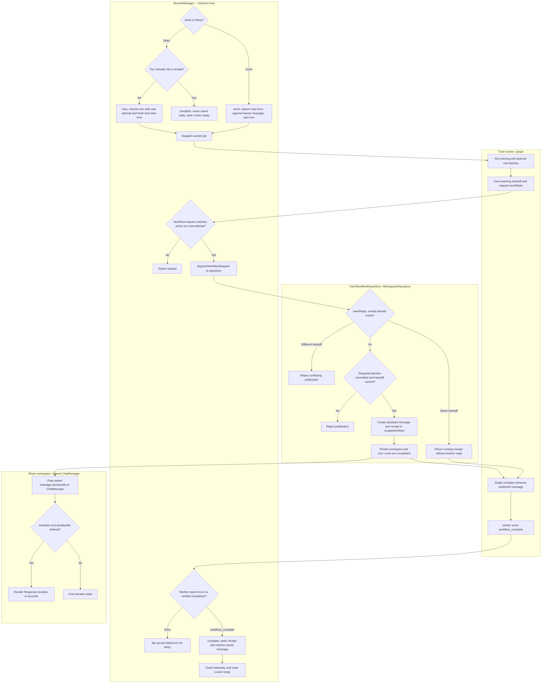

# edu

EdU is an Electron tutoring harness that uses connected model providers to guide learners through course materials, record understanding, and maintain topic, test, and generic scratchpads. The main process owns workspace persistence and runner supervision; utility-process workers execute the tutor workflow; React renders saved messages through the shared UI package. See [repository purpose](../README.md) and [desktop setup](../desktop/README.md).

This exploration applies the repo learner template narrowly to the response duration regression described in [the exploration plan](1_PLAN_EXPLORE.md). It records the current working tree, including existing uncommitted workflow changes. It does not implement the plan's repair or create tests.

## Terminology

### Skill Terms

- `{PLACEHOLDER}` denotes a template value that must be substituted.
- Repository: `edu`, at `/Users/benedicttan/Desktop/projects/edu`.
- Services: Electron main-process `RunnerManager`, persisted `TutorWorkflowRepository` and `WorkspaceRepository`, tutor worker, and React `ChatMessage`.
- Domain: tutoring conversations, their durable workflow turns, and response duration metadata.

### Domain Terms

| Term | Meaning and relevant ownership |
| --- | --- |
| Chat / learner message | Conversation and its user request; `RunnerManager.send` appends the learner message before starting the workflow. |
| Runner | Provider/model configuration supervised by `RunnerManager`; it runs a utility-process worker. |
| Turn | Durable workflow for one learner request; `TutorWorkflowRepository.start` pins its input context. |
| Attempt / Retry | Execution of a turn. Retry resumes a failed unfinished turn with a new attempt ID and no extra learner message; a turn with a receipt can complete without rerunning. |
| Role batch | Scratchpad work delegated by the tutor; all required batches need commit receipts before a reply can publish. |
| Handoff | Verified learning state saved before the tutor reply; it must correspond to the current batches. |
| Assistant reply | Durable `MessageSchema` object created by `TutorWorkflowRepository.saveReply`, separate from transient streamed `runtime.reply`. |
| Turn receipt | Links a completed turn to its saved message and handoff; `complete` retrieves that message and verifies completion. |
| Response duration / `durationMs` | Optional nonnegative milliseconds on a saved message. React passes it to `ChatMessage`, which renders assistant duration in seconds to one decimal place. |
| Host start time | `performance.now()` captured in `RunnerManager.send`; Retry records a fresh start time. It is held in the manager's trace entry, not currently persisted as message duration. |

## Decision Tree

The repository branch above expands `saveReply`; the host dispatcher also routes the graph's other workflow operations. Error branches reject or fail the operation rather than guaranteeing a published reply.

## Response duration findings and verification seam

- [RunnerManager](../desktop/src/runners/manager.ts) captures `startedAt` in `send` and records a fresh timestamp in `retry`. Its workflow-request handler validates chat, turn, and attempt before dispatch. Its `workflow_complete` handler verifies the saved receipt and finishes telemetry, but currently does not attach elapsed time to the reply.
- [TutorWorkflowRepository.saveReply](../desktop/src/main/tutor-workflow.ts) is the publication boundary: it validates batches and handoff, creates the assistant message, and persists message plus receipt through `WorkspaceRepository.mutateWorkflow`. Its message construction currently omits `durationMs`; `complete` only reads the published message.
- [MessageSchema](../desktop/src/shared/contracts.ts) already accepts optional nonnegative `durationMs`. [React workspace](../desktop/src/renderer/workspace.tsx) already forwards it; [ChatMessage](../packages/ui/chat/chat-layout.tsx) already renders it when defined. Optional schema acceptance and a UI test supplied with a fabricated duration cannot establish that a real completed response receives one.

The correct regression seam for duration existence is the real host lifecycle: drive `RunnerManager.send` (and the relevant failed-turn Retry), wait for ready after verified completion, then inspect the receipt-linked assistant message in `WorkspaceRepository` for a defined, finite, positive `durationMs`. Keep the manager, worker transport, workflow repository, and persistence real; substitute the external provider boundary. A fresh repository load can additionally establish durability. Do not inject duration into the fixture, assert only on telemetry, or use an exact wall-clock value for this existence regression.

[desktop/test/workflow-electron.ts](../desktop/test/workflow-electron.ts) already exercises send → delegated scratchpad commit → provider failure → Retry → completed persisted reply. It already asserts that the retried reply has defined, positive `durationMs`. This is the existing matching regression check; coordinate with it before adding a duplicate. It currently checks the saved message through the live repository rather than reopening the workspace. Run it with `pnpm --dir desktop test:electron`; this exploration did not run it or claim a failing result.

[desktop/src/main/tutor-workflow.test.ts](../desktop/src/main/tutor-workflow.test.ts) tests publication gating and idempotency directly. That is useful for repository persistence behavior, but calling `saveReply` directly bypasses the manager's elapsed-time source and cannot by itself verify host timing integration. The exact duration policy across failed attempts is not specified by the plan; the existing Retry check only requires a positive duration on the completed response.
